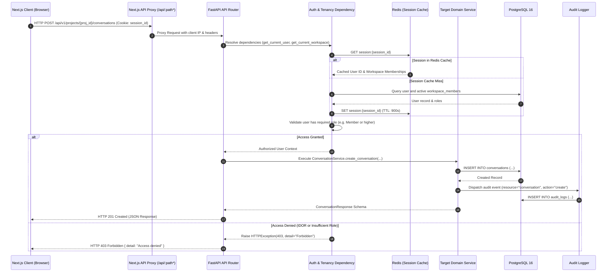
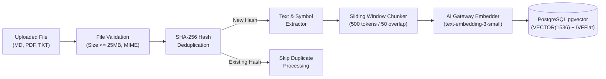
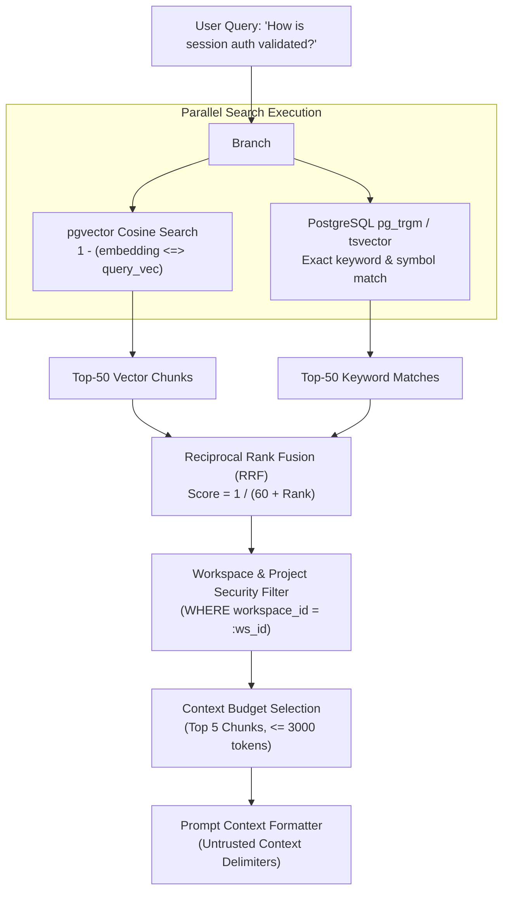
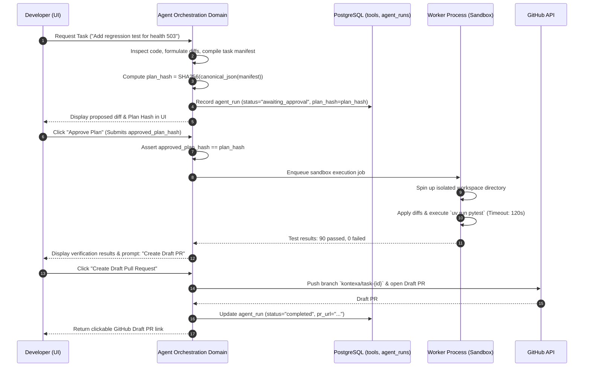

# System Architecture & System Contracts

**System**: Kontexa — AI Software Engineering Workspace  
**Architecture Style**: Modular Monolith with Asynchronous Background Worker  
**Document Version**: 2.0.0  
**Source of Truth**: [docs/README.md](README.md) · [docs/DECISIONS.md](DECISIONS.md) · [docs/PRD.md](PRD.md)

---

## 1. Architectural Philosophy: The Modular Monolith

Kontexa is architected as a **Modular Monolith**. All core backend domain logic (authentication, workspace tenancy, conversational chat, knowledge ingestion, hybrid retrieval, connector integrations, tool dispatch, and audit logging) resides within a single Python 3.12+ package (`backend/src/kontexa/`). Long-running background jobs (connector synchronization, document embedding, and sandboxed test execution) execute in a decoupled worker process sharing the same codebase, PostgreSQL database, and Redis instance.

### Why Avoid Microservices?
1. **Zero RPC & Network Serialization Overhead**: Internal domain boundaries communicate through typed Python interfaces and in-memory function calls rather than internal HTTP/gRPC.
2. **Unified ACID Transaction Boundaries**: Relational entities and pgvector embeddings are updated atomically within standard PostgreSQL transactions, eliminating distributed 2-phase commits or saga patterns.
3. **Streamlined Local Development**: The entire stack boots locally with one command (`docker compose up`) without orchestrating service meshes or discovery daemons.
4. **Pragmatic Scaling**: Independent scaling of compute-intensive tasks (e.g. AST parsing or repository cloning) is handled by horizontally scaling the worker container, not by decomposing the backend into separate microservices.

---

## 2. System Context & Container Architecture

### 2.1 C4 System Context Diagram
The following diagram illustrates how users and external services interact with Kontexa:

```mermaid
flowchart TD
    subgraph Users["Users"]
        Dev["Software Engineer / Tech Lead"]
        Admin["Workspace Owner / Security Admin"]
    end

    subgraph KontexaSystem["Kontexa Platform"]
        KontexaApp["Kontexa AI Software Engineering Workspace"]
    end

    subgraph ExternalEcosystem["External Ecosystem"]
        GitHub["GitHub (App / OAuth / Webhooks)"]
        Trackers["Project Trackers (Linear / Jira)"]
        AIProviders["AI Providers (OpenAI, Anthropic, Gemini)"]
    end

    Dev -->|Interactive Chat, Codebase Q&A, Task Approvals| KontexaApp
    Admin -->|Workspace Management, OAuth Connections, Audit Logs| KontexaApp
    KontexaApp -->|Repo Sync, AST Symbol Parsing, Draft PRs| GitHub
    KontexaApp -->|Issue Sync & Cross-Source Correlation| Trackers
    KontexaApp -->|LLM Prompts & Embedding Vectors (via HTTPS)| AIProviders
```

---

### 2.2 C4 Container Architecture Diagram
The runtime containers, storage tiers, and network boundaries:

```mermaid
flowchart TD
    subgraph ClientZone["Client Zone (Browser)"]
        BrowserApp["Next.js 16 App Router (React 19 / TypeScript)"]
    end

    subgraph EdgeProxy["Edge & Hosting (Vercel)"]
        VercelCDN["Vercel Edge Network / Next.js Serverless"]
        APIRewrite["Next.js API Rewrite (/api/:path* -> Backend)"]
    end

    subgraph BackendZone["Backend Infrastructure (Render / Railway)"]
        subgraph APIService["API Service Container (kontexa-api)"]
            FastAPIEngine["FastAPI Modular Monolith (:8000)"]
            AuthMiddleware["Auth & Workspace Authorization Layer"]
            RouterRegistry["API v1 Route Handlers"]
            AIGateway["AI Gateway & Model Registry"]
        end

        subgraph WorkerService["Worker Service Container (kontexa-worker)"]
            JobConsumer["ARQ / Redis Task Consumer"]
            SyncEngine["Repository & Issue Sync Engine"]
            IngestEngine["Chunking & Embedding Pipeline"]
            SandboxRunner["Sandboxed Workspace Execution Engine"]
        end
    end

    subgraph DataZone["Managed Data Tier (Aiven)"]
        PostgreSQL[("PostgreSQL 16 + pgvector<br/>(18 Relational Tables + VECTOR Chunks)")]
        RedisStore[("Managed Redis 7<br/>(Sessions, Caches, Job Queues)")]
    end

    subgraph ExternalAPIs["External SaaS APIs"]
        ExtLLM["LLM Providers (OpenAI, Anthropic, Gemini)"]
        ExtGit["GitHub REST / GraphQL APIs"]
        ExtLinear["Linear / Jira APIs"]
    end

    BrowserApp -->|HTTPS / SSE| VercelCDN
    VercelCDN --> APIRewrite
    APIRewrite -->|HTTPS / TLS| FastAPIEngine
    FastAPIEngine --> AuthMiddleware
    AuthMiddleware --> RouterRegistry
    RouterRegistry --> AIGateway
    AIGateway -->|HTTPS (TLS 1.3)| ExtLLM

    FastAPIEngine -->|Async SQLAlchemy (TLS)| PostgreSQL
    FastAPIEngine -->|redis-py (PING, Sessions)| RedisStore
    FastAPIEngine -->|Enqueue Background Tasks| RedisStore

    JobConsumer -->|Dequeue Tasks| RedisStore
    JobConsumer --> SyncEngine
    JobConsumer --> IngestEngine
    JobConsumer --> SandboxRunner

    SyncEngine -->|HTTPS| ExtGit
    SyncEngine -->|HTTPS| ExtLinear
    IngestEngine -->|HTTPS Embeddings| ExtLLM
    IngestEngine -->|Store Vectors (TLS)| PostgreSQL
    SandboxRunner -->|Apply Diffs & Run Tests| SandboxRunner
```

---

## 3. Module Boundaries & Domain Decomposition

The backend source code is organized into strict domain modules under `backend/src/kontexa/`. No domain module may bypass another domain's public service interface or execute direct cross-domain SQL queries:

```text
backend/src/kontexa/
├── api/                     # HTTP Presentation Layer
│   ├── v1/                  # Versioned API routes
│   │   ├── auth.py          # /api/v1/auth
│   │   ├── workspaces.py    # /api/v1/workspaces
│   │   ├── projects.py      # /api/v1/projects
│   │   ├── conversations.py # /api/v1/conversations
│   │   ├── documents.py     # /api/v1/documents
│   │   ├── connectors.py    # /api/v1/connectors
│   │   ├── tasks.py         # /api/v1/tasks
│   │   └── audit.py         # /api/v1/audit
│   ├── health.py            # /health & /api/v1/health readiness probes
│   └── dependencies.py      # FastAPI DI: get_current_user, get_current_workspace, get_db
├── core/                    # Cross-cutting Core Utilities
│   ├── config.py            # Pydantic Settings & Aiven TLS configuration
│   ├── health.py            # Concurrent dependency health checkers
│   ├── security.py          # Password hashing (Argon2id), token generation, cryptographic hashing
│   ├── exceptions.py        # Domain exceptions and HTTP mapping
│   └── logging.py           # Structured JSON logging & correlation IDs
├── database/                # Persistence & Data Access
│   ├── session.py           # Async SQLAlchemy engine & async_sessionmaker
│   ├── redis.py             # Redis connection manager
│   └── models/              # 18 SQLAlchemy 2.0 ORM models
├── domains/                 # Business Logic Domains
│   ├── auth/                # Authentication & session service
│   ├── workspaces/          # Workspace tenancy & RBAC membership service
│   ├── chat/                # Conversation orchestration & SSE stream generator
│   ├── ai_gateway/          # Provider adapters, model registry, token accounting
│   ├── knowledge/           # Document parser, sliding-window chunker, RAG retrieval
│   ├── connectors/          # Connector interface, GitHub App sync, AST symbol parser
│   ├── agents/              # Tool registry, plan generator, sandbox runner, PR lifecycle
│   └── audit/               # Audit event dispatcher & tamper-evident logging
└── worker/                  # Background Job Execution
    ├── main.py              # Worker entrypoint (ARQ worker loop)
    └── jobs/                # Job handlers: sync_repo, process_document, execute_sandbox_task
```

### Domain Responsibilities & Invariants

| Module | Core Responsibility | Public Interface | Forbidden Actions |
| :--- | :--- | :--- | :--- |
| **`core`** | Configuration, TLS setup, security primitives, structured logging. | `settings`, `verify_password()`, `hash_password()`, `logger` | Must not import domain modules or models. |
| **`database`** | Session lifecycle, connection pooling, ORM mappings. | `get_db()`, `Base.metadata`, `models.*` | Must not contain business or presentation logic. |
| **`domains.auth`** | User verification, session issuance, cookie lifecycle. | `AuthService.login()`, `AuthService.validate_session()` | Must not read workspace or project tables. |
| **`domains.workspaces`**| Workspace & project CRUD, RBAC role validation. | `WorkspaceService.verify_membership(user, ws, role)` | Must not perform external network calls. |
| **`domains.chat`** | Persistent conversations, prompt assembly, SSE generation. | `ChatService.stream_conversation(conv_id, user_msg)` | Must not call LLM SDKs directly (must use `AIGateway`). |
| **`domains.ai_gateway`**| LLM and embedding vendor isolation, token accounting. | `AIGateway.stream_completion()`, `AIGateway.embed()` | Must not import conversation or document models. |
| **`domains.knowledge`** | Ingestion pipeline, sliding-window chunker, hybrid search. | `KnowledgeService.ingest()`, `KnowledgeService.retrieve()` | Must not execute write operations on git repositories. |
| **`domains.connectors`**| VCS and issue tracker sync, AST symbol indexing. | `ConnectorService.sync_repository()`, `BaseConnector` | Must not bypass workspace tenancy filtering. |
| **`domains.agents`** | Tool registry, immutable plan hashing, sandbox runner. | `AgentService.create_plan()`, `AgentService.execute_task()` | Must never auto-merge or execute unapproved plans. |
| **`domains.audit`** | Security audit event dispatch and query. | `AuditService.log_event(ws_id, user_id, event_type)` | Must not update or delete existing audit log rows. |
| **`worker`** | Out-of-band execution of CPU-heavy and I/O-heavy jobs. | `enqueue_job("sync_repository", repo_id=...)` | Must not handle HTTP requests directly. |

---

## 4. End-to-End Request Flow & Lifecycle



---

## 5. System Contracts & Interfaces

### 5.1 Authentication & Session Contract
- **Session Mechanism**: Stateful, HttpOnly session tokens stored in secure browser cookies.
- **Cookie Attributes**:
  - `Name`: `kontexa_session`
  - `Secure`: `true` (enforced on HTTPS)
  - `HttpOnly`: `true` (unreachable from JavaScript, eliminating XSS token theft)
  - `SameSite`: `Lax` (protects against CSRF on state-changing requests)
  - `Path`: `/`
- **Lookup Architecture**:
  1. Primary: Redis key `session:{token}` storing JSON user profile and active workspace IDs (TTL: 900 seconds, refreshed on active requests).
  2. Fallback: PostgreSQL validation if Redis experiences a cache flush.
  3. Invalidation: `POST /api/v1/auth/logout` explicitly deletes the Redis key and updates `last_logout_at`.

---

### 5.2 API Versioning Strategy
- **Standard Prefix**: All domain and entity routes are namespaced under `/api/v1/`.
- **Breaking Change Policy**: A new major version prefix (`/api/v2/`) is introduced only when breaking contract modifications (renaming required fields, removing endpoints) occur. Non-breaking additions (new optional fields, new endpoints) occur within `v1`.
- **System Health Exception**: Operational readiness probes are available at both `/health` and `/api/v1/health` for compatibility with container orchestration health checkers.

---

### 5.3 Streaming Chat Contract (Server-Sent Events)

Kontexa adopts **Server-Sent Events (SSE)** over WebSockets for conversational streaming:
- **Transport**: Standard HTTP/1.1 or HTTP/2 GET/POST request with `Accept: text/event-stream`.
- **Why SSE over WebSockets?**:
  1. Works seamlessly over corporate firewalls, HTTP proxies, and Vercel edge networks.
  2. Built-in browser reconnection handling.
  3. Simpler authorization: passes standard HttpOnly session cookies.
  4. Half-duplex streaming is ideal: user sends one prompt; server streams multiple tokens.

#### SSE Event Format Specification
```text
event: token
data: {"delta": "To optimize the database pool,"}

event: token
data: {"delta": " update settings.database_pool_size."}

event: citation
data: {"id": "cit_8f92a", "type": "code", "path": "backend/src/kontexa/core/config.py", "lines": [33, 40], "commit": "d0b10fb"}

event: usage
data: {"prompt_tokens": 142, "completion_tokens": 68, "model": "claude-3-5-sonnet", "cost_usd": 0.0014}

event: done
data: [DONE]
```

#### SSE Event Types

| Event Name | Payload Schema | Description |
| :--- | :--- | :--- |
| **`token`** | `{"delta": str}` | Incremental generated text token. |
| **`citation`** | `{"id": str, "type": "code"\|"doc", "path": str, "lines": [int, int], "commit": str}` | Verifiable citation grounding the response. |
| **`tool_call`**| `{"tool": str, "parameters": dict}` | Notification that a tool is being invoked. |
| **`usage`** | `{"prompt_tokens": int, "completion_tokens": int, "model": str, "cost_usd": float}` | Token accounting metadata for the response. |
| **`error`** | `{"code": str, "message": str}` | Streaming error notification before termination. |
| **`done`** | `[DONE]` | Terminal stream event; signals client to close connection. |

---

### 5.4 Connector Interface Contract

All external tools (GitHub, Linear, Jira, Slack) implement a common, typed Python abstract base class (`BaseConnector`):

```python
from abc import ABC, abstractmethod
from typing import Any
from pydantic import BaseModel

class ConnectorSyncResult(BaseModel):
    items_synced: int
    items_deleted: int
    errors: list[str]
    last_sync_commit: str | None = None

class BaseConnector(ABC):
    """Abstract interface defining required capabilities for any Kontexa connector."""

    def __init__(self, workspace_id: str, credentials: dict[str, Any]) -> None:
        self.workspace_id = workspace_id
        self.credentials = credentials

    @abstractmethod
    async def validate_credentials(self) -> bool:
        """Validate whether the stored credentials or OAuth tokens are valid and unexpired."""
        ...

    @abstractmethod
    async def sync_incremental(self, project_id: str, since_checkpoint: str | None) -> ConnectorSyncResult:
        """Perform an incremental synchronization of changed artifacts since last checkpoint."""
        ...

    @abstractmethod
    async def fetch_item(self, external_id: str) -> dict[str, Any]:
        """Fetch a single fresh artifact from the external provider with permission check."""
        ...

    @abstractmethod
    async def revoke_access(self) -> bool:
        """Disconnect the integration and invalidate external OAuth tokens."""
        ...
```

---

### 5.5 Ingestion & Chunking Pipeline Contract



1. **Validation**: Enforce maximum file ceiling (25 MB) and allowed MIME types.
2. **Deduplication**: Compute SHA-256 hash of raw content. If `document_versions.content_hash` matches an existing version in the project, duplicate chunking is skipped.
3. **Sliding-Window Chunking**:
   - Window size: 500 tokens maximum.
   - Overlap: 50 tokens to preserve context across splits.
   - Chunk metadata preserves: `document_id`, `version_number`, `chunk_index`, `start_char`, `end_char`.
4. **Vector Generation**: Text chunks are passed in batches of 64 to `AIGateway.embed()`.
5. **Storage**: Vector floats are inserted into `document_chunks.embedding` (`VECTOR(1536)`).

---

### 5.6 Hybrid Retrieval Pipeline Contract

Kontexa combines semantic vector similarity search with exact lexical keyword matching:



---

### 5.7 AI Gateway & Provider Abstraction Contract

The AI Gateway decouples domain logic from specific model providers (OpenAI, Anthropic, Gemini, or Mock):

```python
from abc import ABC, abstractmethod
from collections.abc import AsyncIterator
from pydantic import BaseModel

class CompletionRequest(BaseModel):
    system_prompt: str
    messages: list[dict[str, str]]
    temperature: float = 0.2
    max_tokens: int = 4096

class BaseAIProvider(ABC):
    @abstractmethod
    async def stream_chat(self, request: CompletionRequest) -> AsyncIterator[str]:
        """Stream generated text chunks from the provider."""
        ...

    @abstractmethod
    async def generate_embeddings(self, texts: list[str]) -> list[list[float]]:
        """Generate 1536-dimensional embedding vectors for input texts."""
        ...
```

- **Mock Provider for Automated CI**: A deterministic `MockProvider` returns canned tokens and mock embeddings without outbound network calls, enabling 100% offline CI verification.

---

### 5.8 Tool Registry & Sandboxed Agent Execution Contract



#### Tool Registry Security Principles
1. **Tool Classification**: Every tool is classified as either `read_only` (e.g. `read_file`, `search_symbols`) or `mutating` (e.g. `write_file`, `execute_command`, `git_push`).
2. **Mandatory Approval for Mutating Tools**: All mutating tools require the developer's cryptographic sign-off.
3. **Execution Sandbox**: Subprocess execution takes place in a non-root, containerized directory with read-only root filesystems and restricted egress.

---

### 5.9 Audit Logging Model

Every sensitive action (login, token refresh, membership change, credential update, tool execution, and PR creation) triggers an immutable audit log entry:

- **Table**: `audit_logs`
- **Fields**:
  - `id`: UUID primary key
  - `workspace_id`: Scoped workspace foreign key
  - `user_id`: Acting user (or `NULL` if system job)
  - `event_type`: Categorized event (e.g. `auth.login`, `tool.execute`, `pr.create`)
  - `resource_type`: Affected entity (`workspace`, `project`, `tool`, `document`)
  - `resource_id`: UUID or identifier of affected entity
  - `metadata`: JSON payload recording client IP, user agent, request ID, and plan hash
  - `created_at`: Non-null timestamp generated by PostgreSQL (`now()`)
- **Immutability Invariant**: The database role used by the application possesses only `INSERT` and `SELECT` privileges on `audit_logs`. `UPDATE` and `DELETE` queries are rejected at the database engine level.

---

## 6. Failure Modes & Mitigation Strategies

| Failure Scenario | Impact | System Mitigation |
| :--- | :--- | :--- |
| **PostgreSQL Outage / Partition** | API cannot read/write data. | Health probes immediately report 503 `degraded`; connection retries use exponential backoff; error masks internal connection strings. |
| **Redis Cache Eviction / Outage** | Session cache misses; queues pause. | Session validation falls back to direct PostgreSQL query; health check reports Redis as unavailable (503); worker gracefully retries job dequeue. |
| **External LLM Provider Outage** | Chat generation fails or times out. | AI Gateway catches provider timeouts (15s limit); emits structured `event: error` on SSE stream; fallback provider adapter invoked if configured. |
| **Sandbox Execution Timeout** | Infinite loop in test execution (`pytest`). | Hard execution timeout enforced at 120 seconds (`asyncio.wait_for`); sandbox worker process is killed (`SIGKILL`) and error reported to user. |
| **Prompt Injection Attack** | Malicious code in repo attempts tool abuse. | Retrieved context is passed with clear contextual data delimiters; tool execution is strictly gated behind cryptographic human plan approval. |
| **Cross-Tenant IDOR Attempt** | User queries another tenant's project ID. | FastAPI dependency validates user's workspace membership on every request; returns 403 Forbidden with audit security event. |

---

## 7. Hosting Model & Production Topology

Kontexa is optimized for straightforward, cost-effective hosting across standard cloud platforms:

1. **Frontend Hosting (Vercel)**:
   - Next.js 16 App Router deployed on Vercel's global edge network.
   - Zero local backend code bundled; proxies API requests via `next.config.ts` rewrite to the backend origin.
2. **Backend Web API (Render / Railway)**:
   - Containerized FastAPI application running `uvicorn kontexa.main:app`.
   - Health probes (`/health`) wired to the cloud platform's zero-downtime health checker.
3. **Background Worker (Render / Railway)**:
   - Identical container image executing the background worker (`python -m kontexa.worker.main`).
   - Scales horizontally independently of the web API based on Redis queue depth.
4. **Persistent Storage (Aiven Managed PostgreSQL 16)**:
   - Managed PostgreSQL instance with `pgvector` enabled.
   - Enforced TLS/SSL with custom CA certificates validated via `DATABASE_CA_CERT`.
5. **Cache & Queue (Aiven / Upstash Managed Redis 7)**:
   - High-throughput in-memory Redis cluster for session lookups and worker task distribution.
