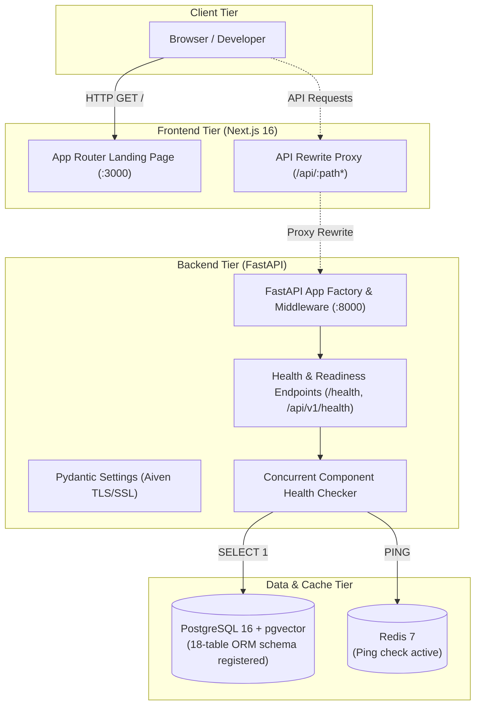
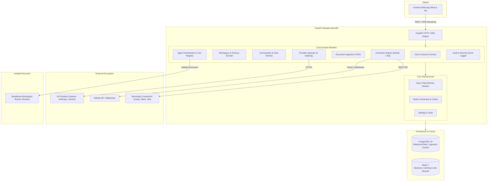

# System Architecture

## 1. Architectural Philosophy: The Modular Monolith

Kontexa is architected as a **Modular Monolith**. All core backend domain logic (authentication, workspace tenancy, chat orchestration, knowledge retrieval, connector integrations, tool dispatch, and audit logging) lives within a single FastAPI application package (`backend/src/kontexa/`).

We deliberately avoid premature microservice decomposition:
- **Simplicity**: Single codebase, unified migration pipeline, straightforward local orchestration, and zero distributed transaction overhead.
- **Strict Domain Boundaries**: Modules communicate via clearly defined Python interfaces and dependency injection rather than internal network calls.
- **Independent Scalability**: If a specific compute-heavy workload emerges (such as background repository parsing or sandboxed code execution), it will be extracted into a dedicated worker service sharing the same database and Redis message broker, not a microservice.

---

## 2. Current vs. Planned Architecture

### Current Implemented Architecture (Sprint 01)

The system currently operates a verified baseline application foundation:

- **Frontend**: Next.js 16 (React 19, TypeScript, Tailwind CSS v4) configured with an App Router landing page and an API rewrite in `next.config.ts`.
- **Backend**: FastAPI modular application exposing `GET /health` and `GET /api/v1/health`.
- **Database**: PostgreSQL 16 with `pgvector`, `uuid-ossp`, and `pgcrypto` extensions. 18 SQLAlchemy models mapped and migrated via Alembic.
- **Cache**: Redis 7 verifying sub-millisecond connectivity.

---

### Target Architecture (Phase 2–Phase 7)

---

## 3. Trust Boundaries & Security Zones

1. **Client / Browser Zone**:
   - Untrusted environment.
   - Holds only short-lived session cookies or JWT tokens.
   - Never receives provider API keys, database credentials, or tenant access keys.
2. **Edge / API Gateway Boundary**:
   - Validates all incoming payloads via Pydantic schemas.
   - Validates authentication and active workspace membership.
   - Rejects unauthorized cross-tenant requests before hitting domain services.
3. **Internal Domain Layer**:
   - Strictly typed domain services.
   - Parameterized queries to prevent SQL injection.
   - Retains context isolation between workspaces.
4. **External Provider Zone**:
   - AI provider APIs, GitHub API, and third-party tools.
   - Outbound requests use least-privilege tokens stored with encryption.
   - Incoming data is treated as untrusted (prompt injection defense).
5. **Execution Sandbox**:
   - Dedicated, resource-limited environment for running user-approved agent development tasks and tests.
   - Isolated from host filesystem, networks, and internal cloud metadata endpoints.

---

## 4. Deployment Posture

- **Local Development**: Fully orchestrated via `infrastructure/docker/docker-compose.yml` (PostgreSQL 16 with pgvector, Redis 7, Backend, and Frontend).
- **Target Production Environment**:
  - **Frontend**: Vercel (Next.js serverless/edge deployment).
  - **Backend API**: Render or Railway (containerized FastAPI service with health/readiness checks).
  - **Database**: Aiven PostgreSQL with pgvector (managed TLS/SSL with CA certificate validation).
  - **Cache**: Managed Redis (Aiven / Upstash).
