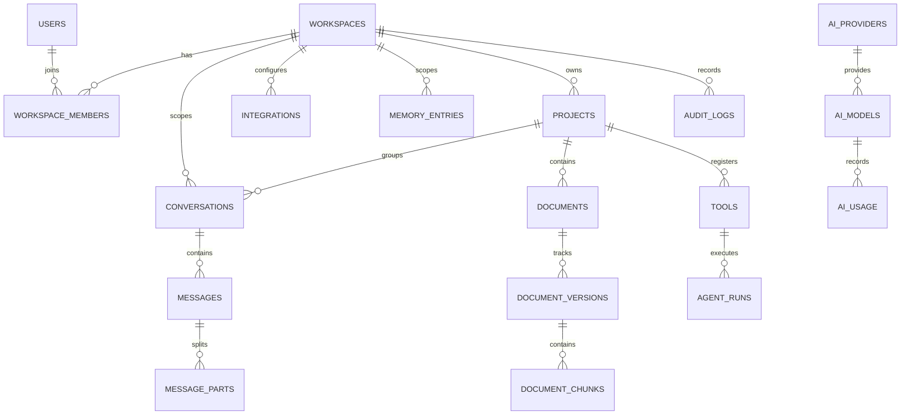

# Database Architecture & Schema

PostgreSQL 16 with the **pgvector** extension serves as Kontexa's persistent relational and vector database.

---

## 1. Schema Sources of Truth

1. **Alembic Migrations** (`backend/migrations/versions/`): The authoritative application schema source of truth.
   - `20260811_0001_initial_schema.py`: Initial schema defining extensions (`pgcrypto`, `uuid-ossp`, `vector`), tables, foreign keys, and indexes.
   - `20260904_0002_schema_hardening.py`: Hardening revision adding composite uniqueness constraints (`message_parts`, `document_chunks`, `ai_models`), foreign key on `memory_entries`, and targeted query indexes.
2. **SQLAlchemy 2.0 ORM Registry** (`backend/src/kontexa/database/models/`): Python object-relational mapping mirroring the database tables.
3. **Bootstrap Script** (`infrastructure/database/schema.sql`): Standalone DDL script intended exclusively for bootstrapping an empty Aiven PostgreSQL database instance. It is not an ongoing migration tool.

---

## 2. Table Catalog (18 Tables)

| Table | Domain | Primary Key | Scoping / Foreign Keys | Description |
| :--- | :--- | :--- | :--- | :--- |
| **`users`** | Identity | UUID | None | User accounts (email, name, is_active, timestamps, deleted_at). |
| **`workspaces`** | Tenancy | UUID | None | Organizational tenant container (name, unique slug, timestamps, deleted_at). |
| **`workspace_members`** | Tenancy | (workspace_id, user_id) | `workspace_id -> workspaces.id` `user_id -> users.id` | Membership roles (`owner`, `admin`, `member`, `viewer`). |
| **`projects`** | Workspace | UUID | `workspace_id -> workspaces.id` | Project container within a workspace (name, slug unique per workspace). |
| **`conversations`** | Chat | UUID | `workspace_id -> workspaces.id` `project_id -> projects.id` (nullable) | Chat thread metadata, timestamps, deleted_at. |
| **`messages`** | Chat | UUID | `conversation_id -> conversations.id` `user_id -> users.id` (nullable) | Chat messages (`user`, `assistant`, `system`). |
| **`message_parts`** | Chat | UUID | `message_id -> messages.id` | Multipart message content (text, code blocks, citations, tool calls). Unique on `(message_id, part_index)`. |
| **`documents`** | Knowledge | UUID | `project_id -> projects.id` | Ingested files/documents (name, path, mime_type, timestamps). |
| **`document_versions`** | Knowledge | UUID | `document_id -> documents.id` | Document version tracking with `content_hash`. |
| **`document_chunks`** | Knowledge | UUID | `document_version_id -> document_versions.id` | Chunked text and vector embeddings (`VECTOR(1536)`). Unique on `(document_version_id, chunk_index)`. |
| **`integrations`** | Connectors | UUID | `workspace_id -> workspaces.id` | External provider configurations and auth tokens (JSON). |
| **`memory_entries`** | Context | UUID | `workspace_id -> workspaces.id` `user_id -> users.id` (nullable) | Scoped key-value persistent memory. |
| **`tools`** | Agent | UUID | `project_id -> projects.id` | Registered tool definitions (parameters JSON, enabled flag). |
| **`agent_runs`** | Agent | UUID | `project_id -> projects.id` `tool_id -> tools.id` (nullable) | Execution records of agent actions (status, input, output, error). |
| **`ai_providers`** | AI Gateway | UUID | None | AI providers (`openai`, `anthropic`, `gemini`, `mock`). |
| **`ai_models`** | AI Gateway | UUID | `provider_id -> ai_providers.id` | Model metadata, context window size, pricing. Unique on `(provider_id, model_name)`. |
| **`ai_usage`** | AI Gateway | UUID | `model_id -> ai_models.id` | Token consumption records (input, output, estimated cost). |
| **`audit_logs`** | Security | UUID | `workspace_id -> workspaces.id` `user_id -> users.id` (nullable) | Tamper-evident audit trail of mutations and access events. |

---

## 3. Entity Relationship Diagram

---

## 4. Vector Storage Specification

- **Column**: `document_chunks.embedding` is defined as `VECTOR(1536)` (nullable).
- **Index**: `idx_chunks_embedding` is an **IVFFlat** index configured with cosine distance (`vector_cosine_ops`) or L2 distance and `lists = 100`.
- **Note on Dimensions**: The 1536-dimensional setting matches standard OpenAI embeddings (`text-embedding-3-small`, `text-embedding-ada-002`). If an alternative embedding model (such as Voyage AI 1024 or Gemini 768) is selected during Sprint 13, a migration will update the column definition and index parameters.

---

## 5. Architectural Risks & Required Hardening (Recorded for Sprint 06)

1. **Cross-Tenant Constraint Gap in Conversations**:
   - `conversations.workspace_id` and `conversations.project_id` have separate foreign keys.
   - *Risk*: A conversation could theoretically be inserted with `workspace_id = A` and `project_id = B` where Project B belongs to Workspace C.
   - *Planned Resolution*: In Sprint 06, add a composite foreign key on `projects(id, workspace_id)` and enforce `conversations(project_id, workspace_id) -> projects(id, workspace_id)`.
2. **Unencrypted Credentials in Integrations**:
   - `integrations.auth_data` stores OAuth tokens and keys as plain JSON.
   - *Risk*: Database dumps or unauthorized DB access exposes external tokens.
   - *Planned Resolution*: In Sprint 06/24, implement application-level AES-256-GCM envelope encryption before storing tokens in `auth_data`.
3. **Soft-Delete Unique Indexing**:
   - `users.email` and `workspaces.slug` have unique constraints on the whole table.
   - *Risk*: Soft-deleting a user (`deleted_at IS NOT NULL`) prevents the same email from ever registering again.
   - *Planned Resolution*: Evaluate moving unique constraints to partial indexes (`WHERE deleted_at IS NULL`) when identity lifecycle is formalized in Sprint 07.
