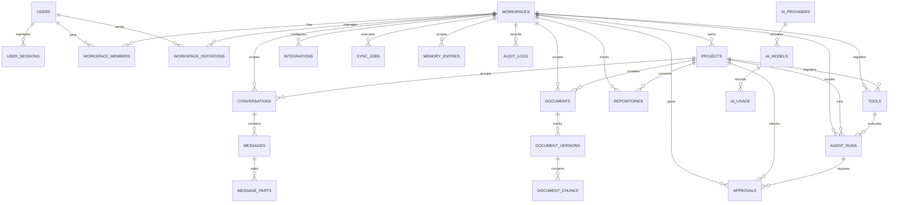

# Database Architecture & Schema

PostgreSQL 16 with the **pgvector** extension serves as Kontexa's persistent relational and vector database.

---

## 1. Schema Sources of Truth

1. **Alembic Migrations** (`backend/migrations/versions/`): The authoritative application schema source of truth.
   - `20260811_0001_initial_schema.py`: Initial schema defining extensions (`pgcrypto`, `uuid-ossp`, `vector`), tables, foreign keys, and indexes.
   - `20260904_0002_schema_hardening.py`: Hardening revision adding composite uniqueness constraints (`message_parts`, `document_chunks`, `ai_models`), foreign key on `memory_entries`, and targeted query indexes.
   - `20261125_0003_tenancy_and_foundation.py`: Tenancy-hardening revision adding composite foreign keys (`projects(id, workspace_id)`), role on messages, user authentication fields, and new tables (`user_sessions`, `workspace_invitations`, `sync_jobs`, `approvals`, `repositories`).
2. **SQLAlchemy 2.0 ORM Registry** (`backend/src/kontexa/database/models/`): Python object-relational mapping mirroring the database tables.
3. **Bootstrap Script** (`infrastructure/database/schema.sql`): Standalone DDL script intended exclusively for bootstrapping an empty Aiven PostgreSQL database instance. It is not an ongoing migration tool.

---

## 2. Table Catalog (23 Tables)

| Table | Domain | Primary Key | Scoping / Foreign Keys | Description |
| :--- | :--- | :--- | :--- | :--- |
| **`users`** | Identity | UUID | None | User accounts (email, name, password_hash, avatar_url, is_active, timestamps, deleted_at). |
| **`user_sessions`** | Identity | UUID | `user_id -> users.id` (CASCADE) | Active user sessions, refresh tokens (SHA-256 hash), user-agent, IP, expiration, revocation. |
| **`workspaces`** | Tenancy | UUID | None | Organizational tenant container (name, unique slug, timestamps, deleted_at). |
| **`workspace_members`** | Tenancy | (workspace_id, user_id) | `workspace_id -> workspaces.id` `user_id -> users.id` | Membership roles (`owner`, `admin`, `member`, `viewer`). |
| **`workspace_invitations`** | Tenancy | UUID | `workspace_id -> workspaces.id` `invited_by_user_id -> users.id` | Pending and resolved workspace member invitations (token hash, status, expiration). |
| **`projects`** | Workspace | UUID | `workspace_id -> workspaces.id` | Project container within a workspace. Unique on `(id, workspace_id)` and `(workspace_id, slug)`. |
| **`conversations`** | Chat | UUID | `workspace_id -> workspaces.id` `(project_id, workspace_id) -> projects(id, workspace_id)` | Chat thread metadata, timestamps, deleted_at. Enforces strict workspace scoping. |
| **`messages`** | Chat | UUID | `conversation_id -> conversations.id` `user_id -> users.id` (nullable) | Chat messages (`role` = user/assistant/system, content, metadata). |
| **`message_parts`** | Chat | UUID | `message_id -> messages.id` | Multipart message content (text, code blocks, citations, tool calls). Unique on `(message_id, part_index)`. |
| **`documents`** | Knowledge | UUID | `workspace_id -> workspaces.id` `(project_id, workspace_id) -> projects(id, workspace_id)` | Ingested files/documents (title, metadata, timestamps). Enforces strict workspace scoping. |
| **`document_versions`** | Knowledge | UUID | `document_id -> documents.id` | Document version tracking with immutable content snapshot. |
| **`document_chunks`** | Knowledge | UUID | `document_version_id -> document_versions.id` | Chunked text and vector embeddings (`VECTOR(1536)`). Unique on `(document_version_id, chunk_index)`. |
| **`integrations`** | Connectors | UUID | `workspace_id -> workspaces.id` | External provider configurations (GitHub, Slack, etc.) and auth metadata. |
| **`sync_jobs`** | Connectors | UUID | `workspace_id -> workspaces.id` `project_id -> projects.id` `integration_id -> integrations.id` | Background connector synchronization runs (job_type, status, trigger, processed records, errors). |
| **`repositories`** | Connectors | UUID | `workspace_id -> workspaces.id` `project_id -> projects.id` `integration_id -> integrations.id` | Connected code repositories (remote_id, full_name, default_branch, indexing status, sync metadata). |
| **`memory_entries`** | Context | UUID | `workspace_id -> workspaces.id` `user_id -> users.id` (nullable) | Scoped key-value persistent memory. |
| **`tools`** | Agent | UUID | `workspace_id -> workspaces.id` `(project_id, workspace_id) -> projects(id, workspace_id)` | Registered tool definitions (parameters JSON, enabled flag). Enforces strict workspace scoping. |
| **`agent_runs`** | Agent | UUID | `workspace_id -> workspaces.id` `project_id -> projects.id` `tool_id -> tools.id` (nullable) | Execution records of agent actions (status, inputs, outputs, error). |
| **`approvals`** | Agent | UUID | `workspace_id -> workspaces.id` `project_id -> projects.id` `agent_run_id -> agent_runs.id` | Gated human-in-the-loop approvals (action_payload, plan_hash, status, reason, expiration). |
| **`ai_providers`** | AI Gateway | UUID | None | AI providers (`openai`, `anthropic`, `gemini`, `mock`). |
| **`ai_models`** | AI Gateway | UUID | `provider_id -> ai_providers.id` | Model metadata, context window size, pricing. Unique on `(provider_id, model_name)`. |
| **`ai_usage`** | AI Gateway | UUID | `model_id -> ai_models.id` `workspace_id -> workspaces.id` `user_id -> users.id` | Token consumption records (input, output, estimated cost). |
| **`audit_logs`** | Security | BigInteger | `workspace_id -> workspaces.id` `user_id -> users.id` | Tamper-evident audit trail of mutations and access events. |

---

## 3. Entity Relationship Diagram

---

## 4. Vector Storage Specification

- **Column**: `document_chunks.embedding` is defined as `VECTOR(1536)` (nullable).
- **Index**: `idx_chunks_embedding` is an **IVFFlat** index configured with cosine distance (`vector_cosine_ops`) or L2 distance and `lists = 100`.
- **Note on Dimensions**: The 1536-dimensional setting matches standard OpenAI embeddings (`text-embedding-3-small`, `text-embedding-ada-002`). If an alternative embedding model (such as Voyage AI 1024 or Gemini 768) is selected during Sprint 13, a migration will update the column definition and index parameters.

---

## 5. Architectural Resolutions & Deletion Strategy

1. **Cross-Tenant Constraint Enforcement (`RESOLVED in 20261125_0003`)**:
   - `projects` defines composite uniqueness on `(id, workspace_id)`.
   - `conversations`, `documents`, and `tools` enforce composite foreign keys referencing `projects(id, workspace_id)`.
   - Result: Database constraints strictly prevent inserting or updating a resource to reference a project belonging to a different tenant workspace.
2. **Deletion & Retention Strategy**:
   - **Soft Delete**: Applied to core organizational and conversational entities (`users`, `workspaces`, `projects`, `conversations`, `integrations`, `repositories`) via `deleted_at TIMESTAMPTZ` with filtered indexes (`WHERE deleted_at IS NULL`). This guarantees immediate logical hiding while allowing compliance retention and restore capability.
   - **Hard Delete (CASCADE)**: Tenant container deletion (`workspaces`) cascades to tenant-owned child data (`workspace_members`, `workspace_invitations`, `projects`, `conversations`, `documents`, `tools`, `agent_runs`, `sync_jobs`, `approvals`, `repositories`, `audit_logs`).
   - **Session Revocation**: `user_sessions` records `revoked_at TIMESTAMPTZ` upon logout or credential rotation; expired sessions are pruned by a background cleanup job.
3. **Unencrypted Credentials in Integrations (`Targeted for Sprint 24`)**:
   - Application-level envelope encryption (AES-256-GCM) will encrypt external OAuth tokens prior to persistence in `integrations.config`.
