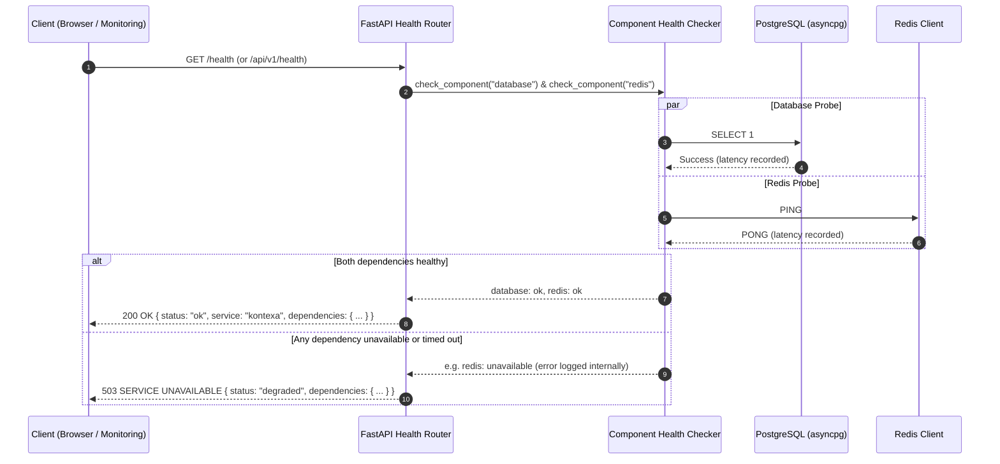
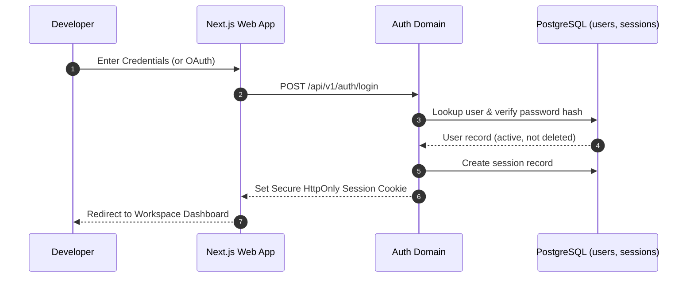
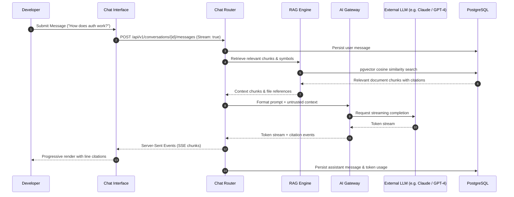
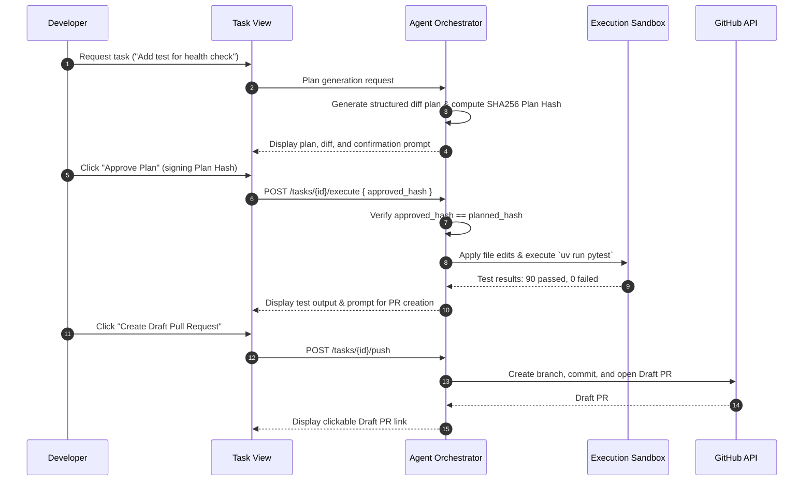

# System & Product Flows

This document details both the currently implemented system flows and the planned product workflows.

---

## 1. Implemented System Flows (Sprint 01)

### A. Dependency Health & Readiness Check Flow

The backend exposes two active endpoints: `GET /health` and `GET /api/v1/health`. Both probe PostgreSQL and Redis concurrently with a configurable timeout guard (`HEALTH_CHECK_TIMEOUT_SECONDS`, default 2.0s).

### B. Health Degradation & Information Hiding Flow

When a dependency probe encounters a connection failure, network timeout, or authorization error:
1. The error details, stack trace, and connection targets are logged strictly on the server at `ERROR` level.
2. The public API response masks all internal credentials, hosts, and raw exception messages.
3. The response payload returns `status: "unavailable"` with `latency_ms: 0.0` and HTTP status `503 Service Unavailable`.

---

## 2. Planned Product Flows

### A. Authentication & Session Verification Flow (Sprint 07)

---

### B. Grounded Chat & SSE Streaming Flow (Sprints 10–12)

---

### C. Human-Approved Agent Task Execution Flow (Sprints 19–21)

