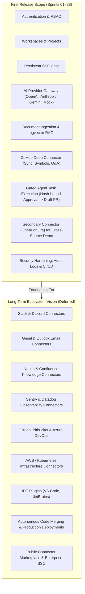

# Product Requirements Document (PRD)

**Product Name**: Kontexa  
**Document Version**: 2.0.0  
**Status**: Authoritative Product Specification  
**Source of Truth**: [docs/README.md](README.md) · [docs/FEATURE_STATUS.md](FEATURE_STATUS.md)

---

## 1. Executive Summary & Vision

Kontexa is an **AI Software Engineering Workspace** designed to bridge the fragmented context of modern software development. Modern engineering teams suffer from severe context dispersion: code lives in Git repositories, decisions reside in Slack threads and email, requirements are tracked in Jira or Linear, design RFCs exist in Notion or Confluence, and operational telemetry streams into Sentry or Datadog.

When diagnosing a defect, onboarding to a service, or implementing a feature, developers expend significant time manually correlating facts across these isolated tools. Kontexa provides a unified, permission-aware context layer that connects developer tools, maintains relational context across sources, and assists engineers through grounded conversational intelligence and gated, human-supervised task execution.

---

## 2. Problem Statement & Market Opportunity

### The Fragmented Context Dilemma
1. **Context Fragmentation**: Critical software knowledge is disconnected across 5+ independent systems. No single tool understands that a production incident is linked to a commit, that the commit was introduced by a pull request, that the PR fulfilled a Jira issue, and that the implementation strategy was debated in a Slack channel.
2. **Hallucination & Lack of Verifiable Grounding**: Generic AI coding assistants lack codebase-wide grounding and hallucinate APIs, imports, and architectural patterns. Developers cannot verify assertions without manual code inspections.
3. **Unsafe Autonomous Execution**: Developers and security leads reject autonomous "black-box" agents that push code, execute unverified commands, or auto-merge pull requests without human review.
4. **Tenant Isolation & Security Vulnerabilities**: Enterprise teams cannot adopt tools that fail to guarantee tenant data isolation, risk prompt injection attacks from untrusted repository files, or expose third-party tokens in client bundles.

---

## 3. Product Principles

1. **Connected Context, Not a Passive Dashboard**: Value arises from understanding semantic and relational links between artifacts across tools, not merely aggregating RSS-like feeds.
2. **Permission-Aware by Design**: A user must never see or retrieve any file, discussion, or issue through Kontexa that they cannot access in the underlying source system.
3. **Evidence Before Confidence**: Every assertion made by the assistant must provide verifiable, clickable citations (file paths, exact line ranges, commit hashes, or document sections). Speculation must be explicitly flagged as hypothetical.
4. **Human-in-the-Loop Control**: Read-only investigation is default. All write operations (creating files, executing commands, pushing branches, opening PRs) require explicit developer confirmation cryptographically bound to an immutable plan hash. Auto-merging is strictly prohibited.
5. **Vendor & Provider Independence**: Third-party LLM and embedding SDKs remain strictly behind domain gateway abstractions. Changing models or providers requires configuration, not code refactoring.
6. **Modular Monolith Foundation**: Build and deploy as a cohesive, single-unit FastAPI modular monolith until measured scaling pressures justify dedicated extraction.

---

## 4. User Personas

### Persona 1: Staff / Senior Software Engineer (Alex)
- **Role**: Core backend/fullstack developer on a complex codebase.
- **Goals**: Rapidly diagnose unfamiliar codebase logic, trace architectural contracts, write accurate regression tests, and automate boilerplate tasks without loss of control.
- **Pain Points**: Spends hours manually grepping repositories and reading outdated documentation; frustrated by generic AI tools generating non-compiling code.
- **Kontexa Use Case**: Uses GitHub Q&A with line citations, investigates bugs through automated retrieval, and triggers gated development tasks that create draft PRs.

### Persona 2: Junior / Onboarding Engineer (Jordan)
- **Role**: New hire or team member rotating into an unfamiliar repository.
- **Goals**: Understand system architecture, locate authoritative entry points, understand naming conventions, and contribute safely.
- **Pain Points**: Hesitant to ask senior engineers routine questions; overwhelmed by undocumented dependencies and historical context.
- **Kontexa Use Case**: Explores project architecture via conversational chat, queries design RFCs, and receives grounded explanations referencing real code files.

### Persona 3: Tech Lead / Engineering Manager (Taylor)
- **Role**: Team lead managing project delivery, code review standards, and system reliability.
- **Goals**: Accelerate review cycles, ensure PRs meet testing and architectural standards, and correlate cross-tool artifacts during post-mortems.
- **Pain Points**: Review fatigue; missing context on why particular design trade-offs were chosen in tickets or discussions.
- **Kontexa Use Case**: Runs "Review Diff" workflows to check pull request adherence against architecture rules; traces incident commits to requirements.

### Persona 4: Workspace Owner / Security Admin (Morgan)
- **Role**: Infrastructure lead or engineering director overseeing workspace boundaries.
- **Goals**: Ensure zero cross-tenant leakage, enforce role-based access control (RBAC), audit all mutating agent actions, and manage OAuth scopes.
- **Pain Points**: Fear of proprietary code leaking to public LLM training sets or unauthorized workspace members accessing restricted project data.
- **Kontexa Use Case**: Configures workspace memberships, monitors audit logs, manages encrypted credentials, and sets data retention policies.

---

## 5. Jobs-to-be-Done (JTBD)

- **JTBD 1 (Codebase Comprehension)**:  
  *When* I am tasked with working on an unfamiliar repository or module,  
  *I want to* ask questions in natural language and receive answers grounded in the repository with exact file and line citations,  
  *So that* I can comprehend system architecture quickly without interrupting teammates.

- **JTBD 2 (Bug Investigation & Diagnosis)**:  
  *When* a production bug or unexpected error occurs,  
  *I want to* supply an error message, stack trace, or defect description and have the system retrieve relevant code, recent commits, and documents,  
  *So that* I can identify probable root causes and review supporting evidence before modifying code.

- **JTBD 3 (Gated Task Execution & Draft PR Creation)**:  
  *When* I need to implement a well-defined code change or unit test suite,  
  *I want* an agent to generate an immutable plan, run tests in an isolated sandbox, and present a diff for my approval before opening a GitHub draft PR,  
  *So that* I can safely accelerate my delivery while maintaining total control over git history.

- **JTBD 4 (Project Knowledge Retrieval)**:  
  *When* I need to consult engineering documentation, API schemas, or RFCs,  
  *I want to* search project knowledge alongside code with semantic and lexical precision,  
  *So that* I do not build features based on obsolete or unindexed documentation.

- **JTBD 5 (Cross-Tool Context Correlation)**:  
  *When* I investigate a past engineering decision,  
  *I want to* trace a commit back to its associated PR, tracking ticket, and team discussion,  
  *So that* I understand the business and technical constraints that drove the original implementation.

---

## 6. Core Workflows & User Journeys

### Journey A: Project-Aware Conversational Assistant
1. **Authentication**: User logs into Kontexa; session cookie is issued and validated.
2. **Context Selection**: User selects their designated Workspace and Project from the workspace navigator.
3. **Conversation Initiation**: User starts a new persistent chat thread or resumes an existing one.
4. **Streaming Response**: User submits a query; backend streams the assistant response via Server-Sent Events (SSE) while rendering tokens progressively.
5. **Persistence**: Thread history and token usage are saved to PostgreSQL under the active project.

### Journey B: Document Knowledge Ingestion & Grounded Search
1. **Upload**: User uploads an engineering document (Markdown, PDF, TXT) to the project knowledge base.
2. **Processing Pipeline**: Background ingestion validates format, computes content SHA256 hash, splits text into sliding-window chunks with metadata, and generates vector embeddings via the AI gateway.
3. **Storage**: Relational records are created in `documents` and `document_versions`; vector chunks are stored in `document_chunks` using `pgvector`.
4. **Retrieval**: When queried, hybrid vector and keyword search selects relevant chunks within the project scope.
5. **Citations**: Responses render clickable badges citing document name, version, and section.

### Journey C: GitHub Repository Intelligence
1. **Connection**: Workspace Admin connects a GitHub App and authorizes access to specific repositories.
2. **Repository Synchronization**: System syncs repository tree, commits, and file contents. A language-aware parser extracts AST symbols, functions, and import dependencies.
3. **Codebase Q&A**: Developer asks: *"How is user authentication validated in incoming requests?"*
4. **Grounded Answer**: Kontexa performs symbol and vector retrieval across code chunks, generating an explanation with precise citations:
   - `backend/src/kontexa/api/health.py#L62-L81`
   - Linked commit SHA: `d0b10fb`

### Journey D: Developer Investigation Workflows
1. **Trigger**: Developer clicks an investigation action: `Explain Code`, `Investigate Bug`, `Suggest Tests`, or `Review Diff`.
2. **Input**: Developer pastes a stack trace or selects a target module.
3. **Evidence Gathering**: System gathers relevant code symbols, recent commit logs, and related documentation.
4. **Structured Report**: Assistant outputs a structured report containing:
   - **Observed Behavior & Evidence**
   - **Probable Hypotheses (with confidence ranking)**
   - **Proposed Remediation Plan**
   - **Recommended Unit Test Cases**

### Journey E: Approved Development Task Execution
1. **Task Brief**: Developer enters a task prompt: *"Add a unit test verifying 503 response on database timeout in health check."*
2. **Plan Generation**: Agent analyzes code, creates target file diffs, and computes a SHA-256 hash of the execution plan (`plan_hash`).
3. **Plan Review UI**: UI presents the proposed changes and plan hash. The execution button is disabled until the developer reviews and clicks **"Approve Plan"**.
4. **Sandboxed Execution**: Agent applies edits in an isolated workspace container and runs `uv run pytest`.
5. **Review Results**: Sandbox reports: `90 passed in 1.25s`. Developer inspects test logs.
6. **Draft PR Approval**: Developer reviews final git diff and clicks **"Create Draft Pull Request"**. Agent pushes a feature branch and opens a GitHub Draft PR with plan evidence and test results attached.

### Journey F: Cross-Source Context Correlation (Secondary Connector)
1. **Secondary Integration**: Workspace Admin connects a project management connector (Linear or Jira).
2. **Issue Linking**: System synchronizes issue identifiers and maps them to commits and PRs referencing the issue key (e.g. `ENG-104`).
3. **Correlated Query**: Developer asks: *"Why was the database pool size lowered to 5?"*
4. **Cross-Source Answer**: Kontexa retrieves the GitHub commit, the pull request discussion, and the Linear issue `ENG-104` ("Aiven free-tier connection limits"), linking all three sources in the answer with verified permissions.

---

## 7. Release Scope: First Release (MVP) vs. Long-Term Vision

### First-Release (MVP) Deliverables
- **Auth & Tenancy**: User accounts, session management, workspaces, projects, and RBAC (`Owner`, `Admin`, `Member`, `Viewer`).
- **Conversational Experience**: Markdown rendering, code syntax highlighting, persistent threads, and SSE token streaming.
- **AI Gateway**: Pluggable provider interface with implementations for primary LLMs and local mock provider for testing.
- **Knowledge Engine**: Document upload, content hashing, sliding-window chunking, pgvector similarity search, and line citations.
- **GitHub Intelligence**: Deep GitHub App connector, repository syncing, AST symbol indexing, codebase Q&A, and diff generation.
- **Safe Agent Workflow**: Hash-bound plan approvals, isolated sandbox execution, automated test verification, and GitHub draft PR creation.
- **Cross-Source Linkage**: One working secondary connector (Linear or Jira) demonstrating cross-source citation.

---

## 8. Connector Roadmap Across Phases

| Phase | Target System | Domain | Depth | Scope / Deliverables |
| :---: | :--- | :--- | :---: | :--- |
| **Phase 1 (MVP)** | **GitHub** | Code & PRs | **Deep** | Repo sync, AST symbol parsing, commit history, branch creation, Draft PRs. |
| **Phase 1 (MVP)** | **Linear / Jira** | Project Tracking | **Core** | Read issues, extract acceptance criteria, link tickets to commits and PRs. |
| **Phase 2** | **Slack / Discord** | Team Chat | Standard | Read authorized channels, link discussion threads to commits and tickets. |
| **Phase 3** | **Notion / Confluence** | Knowledge Base | Standard | Ingest workspace wiki pages, sync architectural RFCs, cite page sections. |
| **Phase 4** | **Gmail / Outlook** | Communication | Standard | Ingest release notifications and customer incident threads with redaction. |
| **Phase 5** | **Sentry / Datadog** | Observability | Standard | Fetch error stack traces, correlate incident alerts with recent deployments. |
| **Phase 6** | **GitLab / Bitbucket** | Code & PRs | Deep | Multi-VCS support for enterprise repositories outside GitHub. |

---

## 9. Functional Requirements & Testable Acceptance Criteria

### Module 1: Authentication & Tenancy

#### `FR-AUTH-01`: User Registration & Credential Verification
- **Description**: Users can create an account and authenticate securely.
- **Acceptance Criteria**:
  - *Given* a valid email and strong password (>= 8 chars), *when* `POST /api/v1/auth/register` is invoked, *then* a new user is created with a hashed password (Argon2id/bcrypt) and HTTP 201 is returned.
  - *Given* an unregistered email or incorrect password, *when* `POST /api/v1/auth/login` is invoked, *then* HTTP 401 Unauthorized is returned without disclosing which field was invalid.
  - *Given* an authenticated session, *when* `POST /api/v1/auth/logout` is invoked, *then* the session cookie/token is invalidated.

#### `FR-TENANT-01`: Workspace Scoping & Multi-Tenant Isolation
- **Description**: All user activity and data must be strictly scoped to a workspace.
- **Acceptance Criteria**:
  - *Given* User A belongs to Workspace 1, *when* User A queries `/api/v1/workspaces/{ws_2_id}/projects`, *then* HTTP 403 Forbidden is returned.
  - *Given* User A creates a project in Workspace 1, *then* `projects.workspace_id` is set to Workspace 1 and is never null.
  - *Given* two distinct workspaces with identical project names, *then* project slugs are unique within each workspace without cross-tenant conflict.

### Module 2: Chat & AI Gateway

#### `FR-CHAT-01`: Persistent Multipart Conversations
- **Description**: Conversations must persist across browser sessions with support for text, code, and citation parts.
- **Acceptance Criteria**:
  - *Given* an active project, *when* `POST /api/v1/projects/{id}/conversations` is invoked, *then* a new conversation is created and returned with an empty message list.
  - *Given* a conversation, *when* messages are appended, *then* `messages` and `message_parts` are created in order with valid `part_index`.

#### `FR-AI-01`: Streamed Token Delivery via Server-Sent Events (SSE)
- **Description**: AI responses stream tokens in real time via SSE.
- **Acceptance Criteria**:
  - *Given* a valid message request, *when* `POST /api/v1/conversations/{id}/messages?stream=true` is called, *then* response headers include `Content-Type: text/event-stream` and SSE events emit formatted JSON tokens (`data: {"delta": "..."}`).
  - *Given* a stream completion, *then* a terminal event (`data: [DONE]`) is transmitted along with final token usage numbers.
  - *Given* client disconnection mid-stream, *then* upstream LLM generation is canceled immediately.

#### `FR-AI-02`: Provider Abstraction & Model Registry
- **Description**: Domain logic must interact only with an `AIGateway` interface.
- **Acceptance Criteria**:
  - *Given* configuration `AI_PROVIDER=mock`, *when* chat endpoints are invoked, *then* deterministic canned tokens stream without outbound network requests.
  - *Given* valid provider API keys, *when* switched between OpenAI, Anthropic, or Gemini via configuration, *then* output schema remains identical.

### Module 3: Knowledge & Retrieval (RAG)

#### `FR-RAG-01`: Document Ingestion, Hashing & Chunking
- **Description**: Uploaded documents are versioned, content-hashed, chunked, and stored with vectors.
- **Acceptance Criteria**:
  - *Given* a document upload, *when* processed, *then* a SHA-256 hash is computed. If identical to the previous version, duplicate chunking is skipped.
  - *Given* a new document, *then* text is split into chunks of at most 500 tokens with 50-token overlap, preserving paragraph boundaries.
  - *Given* chunk generation, *then* vector embeddings (`VECTOR(1536)`) are created and indexed in PostgreSQL.

#### `FR-RAG-02`: Scoped Semantic Retrieval & Citations
- **Description**: Retrieval queries must restrict results to the authorized workspace and project.
- **Acceptance Criteria**:
  - *Given* a retrieval query in Project A, *then* zero chunks belonging to Project B are returned in top-k results.
  - *Given* retrieved context used in an AI answer, *then* every retrieved chunk referenced in the response includes `document_id`, `version_number`, and `chunk_index`.

### Module 4: GitHub Repository Intelligence

#### `FR-GIT-01`: Repository Tree Synchronization & Symbol Indexing
- **Description**: Connect a GitHub repository, sync files, and parse language symbols.
- **Acceptance Criteria**:
  - *Given* valid GitHub App credentials, *when* sync is triggered, *then* repository tree is traversed, respecting `.gitignore`.
  - *Given* supported source files (Python, TypeScript), *then* AST symbols (classes, functions, methods, imports) are extracted with line numbers.
  - *Given* a re-sync, *then* only files modified since the last indexed commit SHA are re-parsed.

#### `FR-GIT-02`: Grounded Codebase Q&A with File/Line Citations
- **Description**: Answering codebase queries with exact file and line references.
- **Acceptance Criteria**:
  - *Given* a question about a function's implementation, *when* answered, *then* the response cites the exact relative path, line start, line end, and commit SHA (e.g. `[src/auth.py#L40-L65](...)`).
  - *Given* a citation emitted in chat, *when* clicked in the UI, *then* the interface displays the referenced file snippet.

### Module 5: Gated Agent Development Tasks

#### `FR-AGENT-01`: Plan Generation with SHA-256 Approval Binding
- **Description**: Agent proposes code changes in an immutable, signed plan.
- **Acceptance Criteria**:
  - *Given* a task request, *when* the agent creates a plan, *then* it generates a canonical JSON manifest of target files, diff hunks, and commands, and calculates `plan_hash = SHA256(manifest)`.
  - *Given* `plan_hash`, *when* execution is attempted without a matching signed `approved_plan_hash`, *then* HTTP 400 Bad Request is returned and no files are touched.

#### `FR-AGENT-02`: Sandboxed Test Execution
- **Description**: Changes are tested in an isolated container.
- **Acceptance Criteria**:
  - *Given* an approved plan, *then* changes are applied inside an isolated temporary directory with read-only host mounts.
  - *Given* test commands (`uv run pytest`), *then* tests execute with a hard timeout (120s) and memory ceiling (2GB).
  - *Given* test failures, *then* execution aborts and the failure trace is returned without modifying git branches.

#### `FR-AGENT-03`: Human Verification & Draft Pull Request Creation
- **Description**: Creation of draft pull requests on GitHub requires explicit human sign-off.
- **Acceptance Criteria**:
  - *Given* passing tests in the sandbox, *when* the user clicks **"Create Draft PR"**, *then* the agent pushes a feature branch (`kontexa/task-<id>`) and calls the GitHub API to open a **Draft PR**.
  - *Given* any agent workflow, *then* the agent is technically prohibited from executing `git merge` or removing branch protection rules.

---

## 10. Role-Based Access Control (RBAC) Permissions Matrix

| Capability / Action | Owner | Admin | Member | Viewer |
| :--- | :---: | :---: | :---: | :---: |
| **Delete Workspace** | Yes | No | No | No |
| **Manage Billing & Retention** | Yes | No | No | No |
| **Manage Members & Roles** | Yes | Yes | No | No |
| **Connect / Disconnect GitHub App** | Yes | Yes | No | No |
| **Manage Integration Credentials** | Yes | Yes | No | No |
| **View Audit Logs** | Yes | Yes | No | No |
| **Create / Archive Projects** | Yes | Yes | Yes | No |
| **Upload Project Documents** | Yes | Yes | Yes | No |
| **Start Conversations & Chat** | Yes | Yes | Yes | Yes |
| **Execute Read-Only Code Search** | Yes | Yes | Yes | Yes |
| **Approve Agent Execution Plan** | Yes | Yes | Yes | No |
| **Authorize GitHub Draft PR Push** | Yes | Yes | Yes | No |

---

## 11. Data Retention, Privacy & Soft-Deletion Policy

1. **Soft Deletion by Default**:
   - Critical entities (`users`, `workspaces`, `projects`, `conversations`, `integrations`) contain a nullable `deleted_at TIMESTAMP WITH TIME ZONE`.
   - Soft-deleted entities are filtered from active queries (`WHERE deleted_at IS NULL`).
   - Foreign key cascading uses `SET NULL` on audit logs and memory entries to preserve historical auditability without maintaining active personal data.
2. **Permanent Data Purge (Hard Delete)**:
   - When a workspace is deleted by an Owner, all child records enter a 30-day grace period with `deleted_at` set.
   - A scheduled retention job permanently purges soft-deleted records after 30 days.
3. **Audit Log Retention**:
   - `audit_logs` entries are retained for a minimum of 365 days for compliance and security forensics.
   - Audit logs are append-only; update and delete operations on `audit_logs` are restricted at the database role level.
4. **Third-Party Data & LLM Privacy**:
   - Zero customer code or documents are submitted to public model training sets.
   - Outbound requests to LLM providers pass enterprise flags opting out of training (e.g. OpenAI Zero Data Retention).
   - Sensitive credentials (OAuth tokens, API keys) are encrypted at rest with AES-256-GCM.

---

## 12. Non-Functional Requirements (NFRs)

- **`NFR-PERF-01` (Readiness Latency)**: Health and readiness endpoints must return responses within 100ms under normal dependency operation.
- **`NFR-PERF-02` (Streaming Latency)**: Time-to-first-token (TTFT) for conversational responses must be under 800ms when using primary cloud LLMs and under 150ms when using mock providers.
- **`NFR-SEC-01` (Tenant Isolation)**: 100% of tenant-owned database tables must have foreign-key scoping to `workspaces`. Automated CI test suites must include cross-tenant access rejection tests.
- **`NFR-SEC-02` (Zero Client Secrets)**: No API keys, OAuth client secrets, database passwords, or private encryption keys may be present in client-side bundles or `NEXT_PUBLIC_*` variables.
- **`NFR-SEC-03` (Subprocess & Shell Safety)**: All sandbox subprocess invocations must use explicit parameter lists (`["git", "status"]`). Shell string execution (`shell=True`) is banned.
- **`NFR-REL-01` (Graceful Degradation)**: If Redis or an external LLM provider experiences an outage, the API must return structured, masked HTTP error payloads without exposing raw stack traces or database connection strings.
- **`NFR-MAINT-01` (Code Quality & Formatting)**: 100% Python code formatted and linted with Ruff (line length 100); 100% TypeScript checked with `tsc --noEmit` and ESLint.

---

## 13. Success Metrics & Key Performance Indicators (KPIs)

1. **Citation Accuracy Rate**: >= 95% of generated citations in codebase Q&A resolve to exact, valid file paths and line ranges in the target repository.
2. **Plan Approval Precision**: >= 85% of agent execution plans are approved by developers on the first attempt without manual plan rejection.
3. **Draft PR Mergeability**: >= 90% of draft pull requests created by the agent pass CI checks on GitHub without syntax errors.
4. **Zero Cross-Tenant Incidents**: Exactly 0 cross-tenant data leakage vulnerabilities or IDOR exposures.
5. **Onboarding Speed**: A newly invited developer can authenticate, join a workspace, and execute a grounded codebase search within 3 minutes of registration.

---

## 14. Explicit Non-Goals for First Release

To maintain strict delivery focus, the following capabilities are explicitly declared **Out of Scope** for the first release:
- **Autonomous Merge & Deploy**: Kontexa will never automatically merge pull requests or trigger production deployments.
- **Full IDE Replacement**: Kontexa will not build a full-featured web-based code editor, terminal emulator, or syntax-highlighting code editor to compete with VS Code or JetBrains.
- **Custom Foundation Model Training**: We will not train custom base models from scratch; we leverage leading foundation models via the provider gateway.
- **Universal Connector Marketplace**: We will not build 20+ shallow integrations. GitHub will be deep; secondary connectors will be added in disciplined, tested sequence.
- **Microservices Infrastructure**: We will not decompose the backend into multiple microservices or deploy Kubernetes clusters for MVP.
