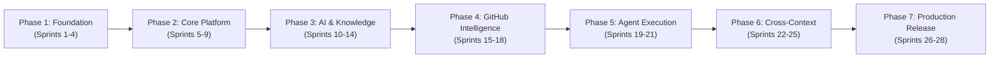

# Implementation Roadmap

This roadmap outlines the complete, sequenced 28-sprint plan to transition Kontexa from its initial architectural foundation into a fully operational AI Software Engineering Workspace.

See [docs/PRD.md](PRD.md) for product requirements and [docs/PRODUCT_SCOPE.md](PRODUCT_SCOPE.md) for MVP scope boundaries and acceptance criteria.

---

## Release Milestones & Phases

---

## Connector Roadmap Across Phases

To avoid building shallow integrations that provide little engineering value, connector rollouts are sequenced strictly by phase:

1. **Phase 1 (MVP)**: **GitHub** (deep connector: file tree sync, AST symbol parsing, commit history, draft PR creation) and **Linear/Jira** (secondary connector: reading tickets, issue state, cross-source link demo).
2. **Phase 2**: **Slack & Discord** (channels, threads, decision context linking).
3. **Phase 3**: **Notion & Confluence** (knowledge wikis, architecture RFCs).
4. **Phase 4**: **Gmail & Outlook** (incident communications, release notices with data redaction).
5. **Phase 5**: **Sentry & Datadog** (error traces, incident alert correlation).
6. **Phase 6**: **GitLab & Bitbucket** (multi-VCS enterprise support).

---

## Sprint Breakdown

### Phase 1: Repository Foundation, Product & Architecture (Sprints 01–04)
- **Sprint 01 — Repository audit and documentation reset** `[COMPLETED]`
  - End-to-end audit of code, tests, migrations, Docker, CI, and docs.
  - Comprehensive documentation reset: README, PRD, Roadmap, Feature Status, Architecture, Decisions, API, Security, Code Rules.
  - Status classification: Implemented, Partial, Planned, Deprecated.
- **Sprint 02 — Product scope, personas and release definition** `[COMPLETED]`
  - Define personas, jobs-to-be-done, core workflows, user journeys (A–F), permissions matrix, retention policy, success metrics, and non-goals.
  - Separate long-term ecosystem vision from first-release MVP scope.
  - Define connector roadmap (GitHub deep connector; Linear/Jira secondary; Slack/Gmail/Notion/Sentry deferred).
  - Define testable acceptance criteria across all MVP capabilities.
- **Sprint 03 — Architecture, ADRs and system contracts** `[COMPLETED]`
  - Target modular-monolith design, worker architecture, streaming contracts (SSE), connector interfaces, retrieval pipelines, AI gateway boundaries, and ADRs (ADR-010 through ADR-015).
- **Sprint 04 — Final repository structure, local developer experience and CI** `[COMPLETED]`
  - Hardening layout, background worker foundation, Mypy type-checking, pre-commit hooks, Docker Compose with worker service, Makefile check runner, Gitleaks secret scanning in CI.

### Phase 2: Database, Tenancy & Application Shell (Sprints 05–09)
- **Sprint 05 — Backend foundation and configuration** `[COMPLETED]`
  - Pydantic Settings hardening, production fail-fast validators, structured logging with correlation request IDs, custom exception hierarchy and handlers, OpenAPI tags, liveness/readiness probes.
- **Sprint 06 — Database foundation and tenancy-ready schema** `[COMPLETED]`
  - Review and finalize SQLAlchemy models and Alembic migrations. 23 tables, composite foreign keys preventing cross-tenant leakage (`projects(id, workspace_id)`), user sessions, workspace invitations, sync jobs, agent execution approvals, repository metadata, offline upgrade/downgrade tests.
- **Sprint 07 — Authentication, session management and identity** `[NEXT SPRINT]`
  - Finalize SQLAlchemy models and Alembic migrations; resolve composite foreign-key constraints; migration upgrade tests.
- **Sprint 07 — Authentication, session management and identity**
  - User registration, password hashing/OAuth, session management, auth middleware, and protected endpoints.
- **Sprint 08 — Workspace tenancy, membership and access control**
  - Workspace/project CRUD, member roles, tenant isolation verification, and cross-workspace access rejection tests.
- **Sprint 09 — Frontend application shell and navigation**
  - Responsive authenticated application shell, workspace switcher, project sidebar, loading and error states.

### Phase 3: Conversational AI & Knowledge Retrieval (Sprints 10–14)
- **Sprint 10 — Conversation and message persistence**
  - Conversation CRUD, multipart message persistence, thread history APIs, and frontend conversation view.
- **Sprint 11 — AI gateway, provider abstraction and model registry**
  - Provider adapters (OpenAI, Anthropic, Gemini), mockable test provider, model configuration, and token accounting.
- **Sprint 12 — Streamed chat experience**
  - SSE streaming endpoint, frontend streaming client, cancellation handling, markdown rendering.
- **Sprint 13 — Knowledge ingestion and document processing**
  - Document upload, text extraction, content hashing, sliding-window chunking, and storage.
- **Sprint 14 — Hybrid retrieval, embeddings and citations**
  - Embedding generation, pgvector similarity search, reranking, source citation attribution in chat answers.

### Phase 4: GitHub Connector & Code Intelligence (Sprints 15–18)
- **Sprint 15 — GitHub connector foundation and repository synchronization**
  - GitHub App integration, OAuth flow, repository selection, file tree synchronization, and background sync jobs.
- **Sprint 16 — Codebase parsing, symbol extraction and dependency graph**
  - Language-aware parsing, symbol table extraction, import analysis, AST indexing.
- **Sprint 17 — Codebase semantic search and repository Q&A**
  - Code chunking, embedding generation, code retrieval, repository Q&A with file and line range citations.
- **Sprint 18 — Developer intelligence workflows**
  - "Explain code", "Investigate bug", "Suggest tests", and "Review pull request" structured workflows.

### Phase 5: Safe Agent Execution & Sandboxed Tasks (Sprints 19–21)
- **Sprint 19 — Tool registry, execution policies and approval workflow**
  - Tool definitions, parameter schemas, read-only vs write classification, approval token hashing.
- **Sprint 20 — Sandboxed workspace and test execution engine**
  - Isolated file editing workspace, path traversal guards, test execution in sandbox, timeout and resource limits.
- **Sprint 21 — Draft pull request lifecycle and human verification**
  - Diff generation, human review UI, draft PR creation via GitHub API upon explicit approval. No auto-merge.

### Phase 6: Cross-Source Context & Hardening (Sprints 22–25)
- **Sprint 22 — Secondary engineering connector**
  - Connect second engineering data source (Linear or Jira); ingest metadata, sync jobs.
- **Sprint 23 — Cross-source context graph and correlation**
  - Correlate issues, PRs, commits, and discussions; demonstrate end-to-end multi-source investigation query.
- **Sprint 24 — Security hardening, audit logging and secret protection**
  - Audit event emitter, token encryption at rest, prompt injection defense hardening, rate limiting.
- **Sprint 25 — Performance, caching and observability**
  - Redis query caching, Prometheus metrics, OpenTelemetry tracing, structured error monitoring.

### Phase 7: Deployment & Release Verification (Sprints 26–28)
- **Sprint 26 — Production deployment and infrastructure runbooks**
  - Staging deployment (Render / Vercel / Aiven), automated migrations, deployment runbooks.
- **Sprint 27 — End-to-end verification, smoke tests and penetration testing**
  - Full E2E test suite, cross-tenant penetration tests, security audit, performance load tests.
- **Sprint 28 — Release documentation, demo environment and launch readiness**
  - User documentation, interactive demo datasets, release notes, and final launch checklist.
